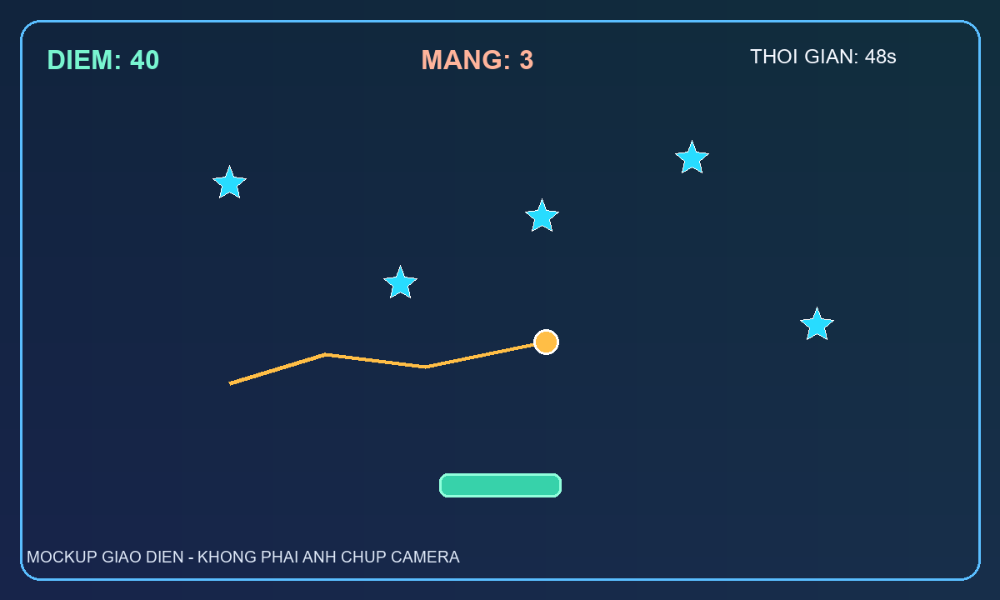

# BÁO CÁO ASSIGNMENT
## Xây dựng ứng dụng tương tác với camera sử dụng MediaPipe

### Trò chơi “Bắt Sao” điều khiển bằng đầu ngón trỏ

**Sinh viên:** ........................................................  
**Lớp:** ........................................................  
**Môn học / giảng viên:** ........................................................  
**Ngày:** 26/10/2026

## 1. Ý tưởng và mục tiêu

“Bắt Sao” là trò chơi điều khiển bằng cử chỉ tay trước webcam. Người chơi di chuyển đầu ngón trỏ sang trái hoặc phải để đưa khay đón các ngôi sao đang rơi. Mục tiêu là đạt điểm cao nhất trong 60 giây mà không mất hết ba mạng.

Mục tiêu kỹ thuật là xây dựng trọn luồng xử lý từ video camera, nhận diện bàn tay bằng MediaPipe, xử lý vị trí landmark bằng logic tự thiết kế, đến cập nhật giao diện và kết quả trò chơi.

## 2. Input và output

| Thành phần | Mô tả |
|---|---|
| Input | Khung hình màu liên tục từ webcam; bàn tay người chơi xuất hiện trong hình |
| Dữ liệu đầu vào xử lý | Tọa độ chuẩn hóa của các landmark bàn tay, đặc biệt là đầu ngón trỏ |
| Hành động | Di chuyển đầu ngón trỏ theo chiều ngang; phím SPACE, R và Q/ESC |
| Output | Khay di chuyển; điểm tăng 10 khi bắt sao; mất một mạng khi để sao rơi; thời gian, số mạng và màn hình kết thúc |

## 3. MediaPipe được sử dụng

Ứng dụng sử dụng **MediaPipe Hand Landmarker** trong chế độ VIDEO. Tác vụ nhận một khung hình RGB kèm dấu thời gian và trả về các landmark bàn tay. Mỗi landmark có tọa độ được chuẩn hóa tương đối với kích thước ảnh. Ứng dụng đặt giới hạn một bàn tay để giảm tải và tập trung vào tay điều khiển.

Landmark số 8 là đầu ngón trỏ. Với tọa độ chuẩn hóa (x_n,y_n) trên khung hình kích thước W × H, tọa độ pixel là:

~~~text
x_p = clip(x_n, 0, 1) × W
y_p = clip(y_n, 0, 1) × H
~~~

Ứng dụng dùng x_p làm đích ngang của khay. Điểm y_p được vẽ lên hình để người chơi nhìn thấy điểm theo dõi. MediaPipe chỉ cung cấp landmark; luật chơi và xử lý sau nhận diện do ứng dụng tự xây dựng.

## 4. Sơ đồ xử lý

~~~text
Webcam → khung hình RGB → Hand Landmarker → landmark ngón trỏ (x,y)
       → chuẩn hóa thành pixel → làm mượt vị trí → điều khiển khay
       → cập nhật sao và kiểm tra va chạm → điểm / mạng / thời gian
       → vẽ giao diện và hiển thị lên màn hình
~~~

## 5. Thuật toán và logic game

### 5.1 Làm mượt tay

Landmark có thể dao động nhẹ giữa các khung hình. Để giảm rung, vị trí khay p_t tiến một phần đến vị trí đo được x_t:

~~~text
p_t = p_(t-1) + α(x_t - p_(t-1)),  α = 0,32
~~~

Giá trị α được chọn để khay theo tay tương đối nhanh nhưng giảm dao động nhỏ. Khi không tìm thấy tay, chương trình không tạo tọa độ mới; khay giữ vị trí gần nhất.

### 5.2 Sinh và di chuyển sao

Khoảng 0,85 giây, ứng dụng sinh một sao mới (tối đa năm sao đang rơi cùng lúc). Vị trí ngang được lấy ngẫu nhiên trong khoảng 12–88% chiều rộng cửa sổ. Mỗi sao có bán kính 13–18 pixel và vận tốc rơi 210–300 pixel/giây. Cập nhật theo thời gian thực:

~~~text
y_(t+Δt) = y_t + vΔt
~~~

Việc dùng Δt giúp tốc độ rơi ít phụ thuộc vào số khung hình mỗi giây.

### 5.3 Va chạm, điểm và kết thúc

Khay có tâm (p_t,y_k), nửa chiều rộng w_k=68 pixel. Một sao bán kính r, tâm (x_s,y_s), được tính là bắt được nếu đồng thời:

~~~text
|x_s - p_t| ≤ w_k + r
y_k - r ≤ y_s ≤ y_k + 14
~~~

Khi bắt sao: cộng 10 điểm và loại sao khỏi màn hình. Khi tâm sao vượt khỏi mép dưới: trừ một mạng. Ván kết thúc khi thời gian còn 0 hoặc số mạng còn 0. Trò chơi bắt đầu với 60 giây và ba mạng.

### 5.4 Vòng đời chương trình

1. Mở camera, tải model nếu chưa có và tạo Hand Landmarker.
2. Đọc khung hình, lật ngang để thao tác giống gương.
3. Chạy nhận diện theo dấu thời gian tăng dần.
4. Lấy landmark số 8, chuyển x sang pixel và cập nhật đích khay.
5. Cập nhật vật thể, kiểm tra va chạm, điểm, mạng và thời gian.
6. Vẽ HUD, khay, sao và điểm theo dõi; đọc phím điều khiển.
7. Khi thoát, giải phóng camera và đóng cửa sổ.

## 6. Giao diện minh họa

Hình dưới đây là **mockup minh họa**, không phải ảnh chụp từ lần chạy webcam. Khi chạy thực tế, nền camera trực tiếp sẽ thay thế nền minh họa.

*Hình 1. Vị trí dự kiến của điểm, mạng, thời gian, sao rơi, chấm đầu ngón trỏ và khay.*

## 7. Kiểm thử và kết quả

Các trường hợp cần chạy trên máy có webcam được liệt kê trong DEMO.md: theo dõi tay ở giữa khung hình, di chuyển tay qua hai mép, và đưa tay ra khỏi khung hình. Bài làm này không ghi số FPS, độ trễ hoặc kết quả nhận diện giả định như thể đã đo thực tế. Các ô kết quả trong bảng ở DEMO.md cần được điền sau khi chạy ứng dụng trên máy nộp bài và nên kèm ảnh chụp webcam thật.

Các điều kiện kết thúc, phím tạm dừng/chơi lại, và phản hồi điểm/mạng được biểu diễn trực tiếp trong source code. Cần xác nhận hành vi trên webcam thực tế vì môi trường soạn báo cáo không có phiên camera đang chạy.

## 8. Khó khăn và giới hạn

- Chất lượng landmark thay đổi theo ánh sáng, nền, góc bàn tay và độ che khuất.
- Camera độ phân giải cao có thể làm giảm tốc độ suy luận trên máy cấu hình yếu.
- Đây là trò chơi 2D dựa trên tọa độ ngang của đầu ngón trỏ; chưa đánh giá khoảng cách tay đến camera.
- Giao diện OpenCV dùng chữ không dấu để tránh lỗi font trên các máy khác nhau.
- Báo cáo có mockup giao diện; ảnh/video demo thực tế cần được ghi khi ứng dụng chạy.

## 9. Hướng phát triển

- Thêm hiệu chỉnh vùng điều khiển theo kích thước hình ảnh để phù hợp nhiều webcam.
- Dùng khoảng cách giữa ngón trỏ và ngón cái để bật/tắt khay hoặc tạo thao tác xác nhận.
- Thêm nhiều loại vật thể, cấp độ khó, âm thanh và lưu bảng điểm.
- Ghi lại thống kê FPS và độ trễ trong các điều kiện sáng khác nhau.

## 10. Tài liệu tham khảo

1. Google AI for Developers, “Hand Landmarker guide”: https://ai.google.dev/edge/mediapipe/solutions/vision/hand_landmarker
2. Google AI for Developers, “HandLandmarker Python API”: https://ai.google.dev/edge/api/mediapipe/python/mp/tasks/vision/HandLandmarker
3. MediaPipe model storage, Hand Landmarker model: https://storage.googleapis.com/mediapipe-models/hand_landmarker/hand_landmarker/float16/1/hand_landmarker.task

---

**Tệp nộp cùng báo cáo:** app.py, requirements.txt, README.md, DEMO.md; repository có thể tạo theo hướng dẫn trong README. Video demo và dữ liệu đo thực tế cần được bổ sung sau khi chạy bằng webcam.
